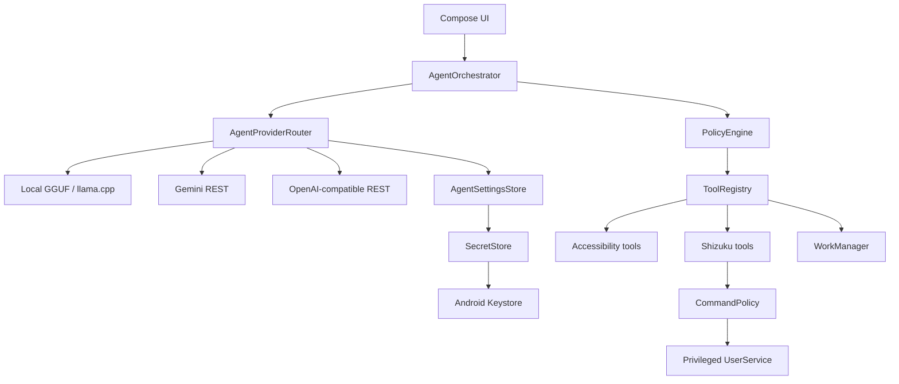

# Jarvis | AuthorAI — unified Android agent repository

[](https://github.com/VadymYem/Jarvis)
[](LICENSE)
[](https://developer.android.com/)
[](https://kotlinlang.org/)

> **Single canonical branch:** `main`. It contains the native Kotlin/Compose agent implementation plus the PocketPal-based release layer under `pocketpal/`. The full Android test APK is reconstructed and built from `main` by `.github/workflows/jarvis-pocketpal-build.yml`.

**Android AI agent architecture showcase by AuthorChe.**

> Portfolio repository — engineering case study, not a production distribution channel.

Jarvis | AuthorAI is a native Android proof-of-concept that explores how an AI agent can plan tasks, reason over Android UI state, call constrained tools, and execute privileged actions without giving the language model unrestricted access to the operating system.

The project is intentionally published as a **portfolio snapshot**. It demonstrates architecture, Android engineering, local inference, provider abstraction, permission boundaries, security controls, and agent orchestration. No production releases, hosted backend, managed user accounts, or public support lifecycle are provided from this repository.

## What this project demonstrates

- Native Android development with **Kotlin** and **Jetpack Compose**
- Agent loop: `plan → approve → act → observe → verify`
- Local `.gguf` inference through **llama.cpp / JNI**
- Cloud model adapters for **Gemini**, **OpenAI**, **Groq**, and OpenAI-compatible HTTPS APIs
- Provider routing behind a common `AgentProvider` contract
- Android Accessibility-based semantic UI observation and automation
- Privileged Android actions through **Shizuku UserService**
- Risk-aware tool execution with `ALLOW / ASK / DENY`
- Keystore-backed API credential encryption with **AES-GCM**
- Local reminders with WorkManager
- Explicit separation between model reasoning and Android execution
- Unit-tested policy and command-boundary components
- CI verification for reproducible portfolio builds

## Architecture



The model never receives a raw Android `Context`, Binder interface, Shizuku object, or arbitrary shell primitive. It can only request typed tools registered by the application. The orchestrator evaluates the requested action, applies the risk policy, asks the user for confirmation when required, and only then executes the tool.

## Security model

The portfolio focuses heavily on privilege separation.

| Boundary | Design |
|---|---|
| Model → Android | Typed tool contracts only |
| Privileged actions | Shizuku UserService behind an allowlisted command policy |
| Risky operations | Explicit confirmation for medium/high-risk actions |
| Unknown shell actions | Denied |
| API credentials | AES-GCM ciphertext with key material held by Android Keystore |
| Cloud transport | HTTPS-only endpoints |
| Android backup | Secrets, preferences, and local models excluded |
| Accessibility passwords | Password nodes are masked before model use |

See [SECURITY.md](SECURITY.md) for the threat model and [docs/ARCHITECTURE.md](docs/ARCHITECTURE.md) for the component design.

## Authentication and credentials

This snapshot intentionally has **no AuthorAI account system** and no application-level OAuth/JWT session layer.

Cloud providers use user-supplied API credentials:

```text
User enters provider API key
        ↓
SecretStore
        ↓
AES-GCM encryption
        ↓
Android Keystore-backed key
        ↓
encrypted local SharedPreferences
        ↓
decrypted only when a provider request is made
        ↓
HTTPS request
```

OpenAI-compatible providers receive the credential through the standard `Authorization: Bearer …` header. Gemini uses `x-goog-api-key`. Local GGUF inference requires no network credential.

Shizuku authorization is a separate Android permission flow controlled by Shizuku and Android, not by a token stored by this application.

## Project structure

```text
app/src/main/java/top/authorche/agent/
├── agent/          Agent loop, policies, tool contracts
├── provider/       Local and cloud model providers
├── security/       Keystore-backed credential storage
├── accessibility/  Semantic Android UI bridge
├── shizuku/        Privileged service and command policy
├── tools/          Executable agent tools
└── ui/             Compose theme and presentation

docs/
├── ARCHITECTURE.md
├── CASE_STUDY.md
└── FUNCTIONS.md
```

## Additions over baseline PocketPal AI

Baseline [PocketPal AI](https://github.com/a-ghorbani/pocketpal-ai) is an open-source React Native client primarily focused on chatting with local language models using llama.rn / llama.cpp.

This repository extends that foundation with two major components: a completely original native Android agent architecture (`app/`) and an enhanced PocketPal runtime release layer (`pocketpal/`):

### 1. Native Android Agent Architecture (`app/`)
- **Full Agent Loop (`plan → approve → act → observe → verify`)**: Autonomous multi-step problem solving with an explicit budget (capped at 16 steps) and execution traces.
- **Unified Provider Abstraction**: Dynamic runtime switching between local on-device `.gguf` inference (via direct JNI bindings to llama.cpp) and cloud providers (Gemini REST, OpenAI, Groq) behind a single `AgentProvider` interface.
- **Android UI Automation via Accessibility**: Inspects the active semantic node hierarchy, executes clicks, scrolls, text input, and system actions (`Back`, `Home`), with automated password field masking.
- **Privileged System Operations via Shizuku**: Rootless execution of elevated Android tasks (force stopping applications, inspecting system dumpsys state, tweaking select Android settings) through a dedicated Binder `UserService`.
- **Human-in-the-Loop Risk Policy Engine**: Deterministic classification of all tool calls (`ALLOW / ASK / DENY`), requiring user consent for medium and high risk actions and rejecting dangerous shell strings.
- **Android Keystore Credential Vault**: Cloud API keys are encrypted with AES-GCM using hardware-backed key material in the Android Keystore, stored in private preferences, and never leaked to backups.
- **WorkManager Reminders**: Schedules and manages background reminder tasks delivered through system notification channels.
- **Multilingual Voice Session**: Foreground voice interaction with real-time speech recognition, turn management, TextToSpeech, and Ukrainian language support.
- **Offline Device & Knowledge Search**: Scoped storage file searching via Android Document Picker, package launcher scanning, and keyless Wikipedia/GitHub offline search routing.

### 2. PocketPal Runtime Release Enhancements (`pocketpal/`)
- **Work Mode inside Chat**: Embedded structured JSON tool execution protocol tailored for models such as Gemma 3 and Mamay, enabling on-device file generation, code inspection, and project checks directly in chat turns.
- **Offline ZIM Knowledge Integration**: Local offline search and reading of ZIM archives (such as offline Wikipedia), completely independent of internet access.
- **Native llama.cpp Grammar Sampler Fix**: Resolved a critical upstream prefill crash where model template prefixes caused the grammar sampler to throw `std::exception`, ensuring reliable JSON schema-constrained generation.
- **Translator PAL**: Specialized bilingual assistant mode supporting quick translation, linguistic explanations, and examples.
- **Background Execution & Wakelock**: Persistent background execution for long-running inference tasks with partial wake locks.

## Selected implementation details

### Provider abstraction

`AgentProviderRouter` selects local or cloud inference at runtime while the orchestrator depends only on the common `AgentProvider` interface. This keeps model choice independent from Android tool execution.

### Constrained privileged execution

The agent does not execute arbitrary model-generated shell strings. Privileged actions are represented as structured arguments, passed through the application policy layer, validated by `CommandPolicy`, and only then forwarded to the Shizuku-backed service.

### Local-first model option

A user-provided GGUF file is copied into app-private storage, validated before use, and executed locally through llama.cpp. The local path does not require an API key or cloud request.

### Human-in-the-loop risk control

The policy engine maps actions to four risk levels:

- `LOW` → allowed
- `MEDIUM` → user confirmation
- `HIGH` → user confirmation
- `CRITICAL` → denied

This is deliberately simple and auditable for a portfolio implementation.

## Build verification

Requirements:

- Android Studio with current Android tooling
- Android SDK 36
- Android 11 (API 30) or newer for the bundled llama.cpp native target
- JDK 17
- Gradle 8.13

Command-line verification:

```bash
gradle --no-daemon :app:assembleDebug :app:testDebugUnitTest
```

For local builds, decode the committed test key first:

```bash
base64 --decode signing/jarvis-debug.jks.b64 > signing/jarvis-debug.jks
```

The repository contains a stable sample **debug testing key** so CI APKs can update one another. Anyone with access to the repository can copy this key. Never use it to sign a production or Play Store release. APKs created with earlier runner-generated debug keys require a one-time uninstall before this build can be installed.

GitHub Actions on `main` verifies the native agent build/unit tests and reconstructs the PocketPal release from the pinned upstream revision plus the repository patch.

## Scope

The v0.3 prototype adds a visible agent tool list, simple commands that work without a model, on-device app and selected-folder file search, Wikipedia and GitHub search without keys, optional SearXNG/Brave search, and a foreground turn-based voice session. See [docs/FUNCTIONS.md](docs/FUNCTIONS.md) for exact capabilities and current boundaries.

This repository is intended to demonstrate engineering decisions and source quality. It is not presented as:

- a production-ready personal assistant;
- an app-store release;
- a hosted SaaS product;
- a supported binary distribution;
- a finished autonomous-agent platform.

The code remains buildable so reviewers can inspect real implementations rather than mockups.

## Case study

A concise engineering write-up covering the problem, architecture, security boundaries, trade-offs, and skills demonstrated is available in [docs/CASE_STUDY.md](docs/CASE_STUDY.md).

## Third-party technology

The project builds upon and integrates with PocketPal AI, Shizuku API, llama.cpp, AndroidX, Kotlin, OkHttp, and published mobile-agent research. Detailed attribution, copyright notices, and license terms are documented in [THIRD_PARTY_NOTICES.md](THIRD_PARTY_NOTICES.md).

## License

GNU AGPL-3.0-only.

© 2026 Vadym Yemelianov / AuthorChe
