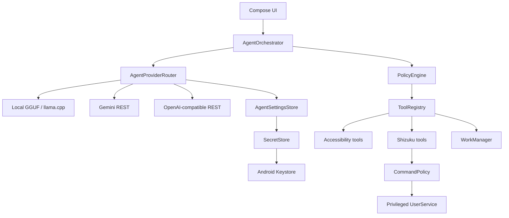

# Jarvis | AuthorAI

**Android AI agent architecture showcase by AuthorChe.**

> Portfolio repository — engineering case study, not a production distribution channel.

Jarvis | AuthorAI is a native Android proof-of-concept that explores how an AI agent can plan tasks, reason over Android UI state, call constrained tools, and execute privileged actions without giving the language model unrestricted access to the operating system.

The project is intentionally published as a **portfolio snapshot**. It demonstrates architecture, Android engineering, local inference, provider abstraction, permission boundaries, security controls, and agent orchestration. No production releases, hosted backend, managed user accounts, or public support lifecycle are provided from this repository.

## What this project demonstrates

- Native Android development with **Kotlin** and **Jetpack Compose**
- Agent loop: `plan → approve → act → observe → verify`
- Local `.gguf` inference through **llama.cpp / JNI**
- Cloud model adapters for **Gemini**, **OpenAI**, **Groq**, and OpenAI-compatible HTTPS APIs
- Provider routing behind a common `AgentProvider` contract
- Android Accessibility-based semantic UI observation and automation
- Privileged Android actions through **Shizuku UserService**
- Risk-aware tool execution with `ALLOW / ASK / DENY`
- Keystore-backed API credential encryption with **AES-GCM**
- Local reminders with WorkManager
- Explicit separation between model reasoning and Android execution
- Unit-tested policy and command-boundary components
- CI verification for reproducible portfolio builds

## Architecture



The model never receives a raw Android `Context`, Binder interface, Shizuku object, or arbitrary shell primitive. It can only request typed tools registered by the application. The orchestrator evaluates the requested action, applies the risk policy, asks the user for confirmation when required, and only then executes the tool.

## Security model

The portfolio focuses heavily on privilege separation.

| Boundary | Design |
|---|---|
| Model → Android | Typed tool contracts only |
| Privileged actions | Shizuku UserService behind an allowlisted command policy |
| Risky operations | Explicit confirmation for medium/high-risk actions |
| Unknown shell actions | Denied |
| API credentials | AES-GCM ciphertext with key material held by Android Keystore |
| Cloud transport | HTTPS-only endpoints |
| Android backup | Secrets, preferences, and local models excluded |
| Accessibility passwords | Password nodes are masked before model use |

See [SECURITY.md](SECURITY.md) for the threat model and [docs/ARCHITECTURE.md](docs/ARCHITECTURE.md) for the component design.

## Authentication and credentials

This snapshot intentionally has **no AuthorAI account system** and no application-level OAuth/JWT session layer.

Cloud providers use user-supplied API credentials:

```text
User enters provider API key
        ↓
SecretStore
        ↓
AES-GCM encryption
        ↓
Android Keystore-backed key
        ↓
encrypted local SharedPreferences
        ↓
decrypted only when a provider request is made
        ↓
HTTPS request
```

OpenAI-compatible providers receive the credential through the standard `Authorization: Bearer …` header. Gemini uses `x-goog-api-key`. Local GGUF inference requires no network credential.

Shizuku authorization is a separate Android permission flow controlled by Shizuku and Android, not by a token stored by this application.

## Project structure

```text
app/src/main/java/top/authorche/agent/
├── agent/          Agent loop, policies, tool contracts
├── provider/       Local and cloud model providers
├── security/       Keystore-backed credential storage
├── accessibility/  Semantic Android UI bridge
├── shizuku/        Privileged service and command policy
├── tools/          Executable agent tools
└── ui/             Compose theme and presentation

docs/
├── ARCHITECTURE.md
├── CASE_STUDY.md
└── FUNCTIONS.md
```

## Selected implementation details

### Provider abstraction

`AgentProviderRouter` selects local or cloud inference at runtime while the orchestrator depends only on the common `AgentProvider` interface. This keeps model choice independent from Android tool execution.

### Constrained privileged execution

The agent does not execute arbitrary model-generated shell strings. Privileged actions are represented as structured arguments, passed through the application policy layer, validated by `CommandPolicy`, and only then forwarded to the Shizuku-backed service.

### Local-first model option

A user-provided GGUF file is copied into app-private storage, validated before use, and executed locally through llama.cpp. The local path does not require an API key or cloud request.

### Human-in-the-loop risk control

The policy engine maps actions to four risk levels:

- `LOW` → allowed
- `MEDIUM` → user confirmation
- `HIGH` → user confirmation
- `CRITICAL` → denied

This is deliberately simple and auditable for a portfolio implementation.

## Build verification

Requirements:

- Android Studio with current Android tooling
- Android SDK 36
- JDK 17
- Gradle 8.13

Command-line verification:

```bash
gradle --no-daemon :app:assembleDebug :app:testDebugUnitTest
```

The GitHub Actions workflow performs build and unit-test verification only. It does **not** publish APKs or releases.

## Scope

The v0.3 snapshot adds a visible agent tool list, simple commands that work without a model, Wikipedia and GitHub search without keys, optional SearXNG/Brave search, and a foreground turn-based voice session. The workflow uploads a debug APK for device testing. See [docs/FUNCTIONS.md](docs/FUNCTIONS.md) for exact capabilities and current boundaries.

This repository is intended to demonstrate engineering decisions and source quality. It is not presented as:

- a production-ready personal assistant;
- an app-store release;
- a hosted SaaS product;
- a supported binary distribution;
- a finished autonomous-agent platform.

The code remains buildable so reviewers can inspect real implementations rather than mockups.

## Case study

A concise engineering write-up covering the problem, architecture, security boundaries, trade-offs, and skills demonstrated is available in [docs/CASE_STUDY.md](docs/CASE_STUDY.md).

## Third-party technology

The project uses or references Shizuku API, llama.cpp, AndroidX, Kotlin, OkHttp, and published mobile-agent research/architecture work. Attribution and license notes are documented in [THIRD_PARTY_NOTICES.md](THIRD_PARTY_NOTICES.md).

## License

GNU AGPL-3.0-only.

© 2026 Vadym Yemelianov / AuthorChe
