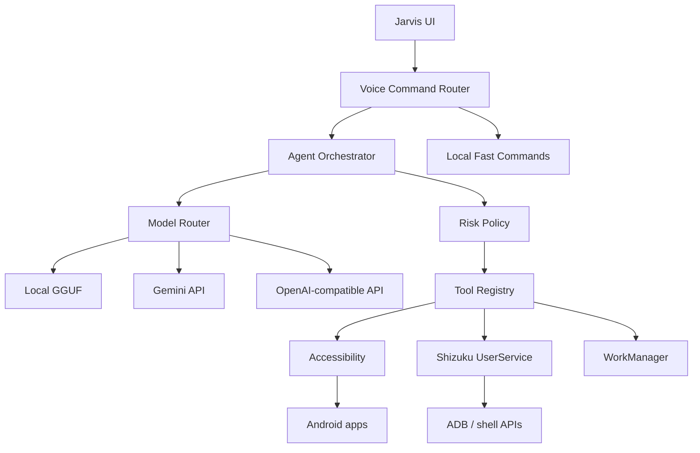

# Jarvis | AuthorAi

**Ваш приватний голосовий AI-агент для Android — by AuthorChe.**

Jarvis | AuthorAi приймає текстові й голосові завдання, планує короткі перевірювані кроки та взаємодіє з Android через семантичне дерево інтерфейсу, системні Android API й дозволені ADB-операції через Shizuku. Застосунок повністю автономний від `ai.authorche.top`.

> Технології можуть бути красивими, коли в них є душа.

## Що вже працює

- нативний Android-застосунок на Kotlin і Jetpack Compose;
- агентний цикл `plan → approve → act → observe → verify` до 16 кроків;
- локальні `.gguf`-моделі через нативний `llama.cpp` без інтернету;
- нативний Gemini API;
- OpenAI/GPT, Groq та інші OpenAI-сумісні HTTPS API;
- голосовий режим із системним або on-device Android SpeechRecognizer;
- локальні швидкі команди українською, російською, англійською й німецькою;
- озвучення відповідей через Android TTS;
- команда «Джарвіс, де ти?» без звернення до LLM;
- реєстрація як системного цифрового помічника Android через Assistant role;
- пошук `Downloads/was-wollen-wir-trinken.mp3`, циклічне гучне відтворення, вібрація та кнопка зупинки у сповіщенні;
- локальний голосовий профіль з еталонним аудіо для майбутнього clone-TTS рушія;
- шифрування API-ключа апаратно захищеним Android Keystore;
- відкриття застосунків за назвою або package name;
- читання Accessibility-дерева з маскуванням полів паролів;
- натискання видимого елемента, введення тексту, прокручування, `Назад` і `Додому`;
- локальні нагадування через WorkManager;
- Shizuku UserService із UID `shell` або `root`;
- білий список ADB-дій: `force-stop`, Android Settings, key events, керування runtime permissions, `settings put`, читання активного Activity;
- політика ризику `ALLOW / ASK / DENY` і журнал кожного кроку;
- світла й темна тема AuthorChe.

## Архітектура



Архітектурні принципи довготривалих задач, реєстру інструментів, політик і журналу дій узяті з досвіду [Capka](https://github.com/LyoSU/capka). Android-виконання спирається на офіційний [Shizuku API](https://github.com/RikkaApps/Shizuku-API). Підходи до `observe → act → reflect` звірені з [Mobile-Agent](https://github.com/X-PLUG/MobileAgent), але код Android-застосунку написаний окремо нативною мовою Kotlin.

## Запуск

1. Відкрийте репозиторій в актуальній Android Studio.
2. Встановіть Android SDK 36 і JDK 17.
3. Зберіть `app` у варіанті `debug`.
4. Встановіть [Shizuku](https://shizuku.rikka.app/download/) і запустіть його через Wireless debugging або root.
5. У Jarvis | AuthorAi увімкніть службу спеціальних можливостей і надайте Shizuku-дозвіл.
6. Відкрийте «Модель» й оберіть Local GGUF, Gemini, OpenAI/GPT, Groq або сумісний endpoint.
7. Для пошуку телефона покладіть файл `was-wollen-wir-trinken.mp3` у системну папку `Downloads` і надайте доступ до музики при першому запуску голосового режиму.

Для локального режиму імпортуйте файл `.gguf` через системний вибір файлів. Модель копіюється у приватне сховище застосунку, перевіряється за сигнатурою GGUF і виконується нативно через `llama.cpp`. Поточна native-збірка оптимізована для `arm64-v8a`.

Командна збірка з установленим Gradle 8.13:

```bash
gradle --no-daemon :app:assembleDebug :app:testDebugUnitTest
```

## Межі Android і приватність

- Захоплення екрана на звичайному Android вимагає видимого системного підтвердження MediaProjection для кожної сесії. Прихованої трансляції немає.
- Звичайний застосунок не має права записувати обидві сторони телефонного дзвінка. `CAPTURE_AUDIO_OUTPUT` доступний лише привілейованим, попередньо встановленим застосункам. Shizuku не робить сторонній APK системним застосунком.
- Тому проєкт не записує дзвінки приховано. Запланований режим голосових нотаток буде запускатися користувачем, показувати постійний індикатор і зберігати дані локально.
- Accessibility-вміст не пишеться на диск за замовчуванням. Поля паролів маскуються до передавання моделі.
- Довільна shell-команда від моделі ніколи не виконується: параметри перевіряє `CommandPolicy`.
- Команди часу, заряду батареї та пошуку телефона виконуються локально до звернення до LLM.
- Голосовий еталон і вибрана музика не завантажуються на сервер. Поточна версія не видає системний TTS за клон: справжній локальний clone-TTS підключатиметься окремим ONNX-модулем.

Повний перелік: [FUNCTIONS.md](docs/FUNCTIONS.md). Докладніше про реалізацію: [ARCHITECTURE.md](docs/ARCHITECTURE.md), [ROADMAP.md](docs/ROADMAP.md), [SECURITY.md](SECURITY.md).

## Ліцензія

Jarvis | AuthorAi поширюється за GNU AGPL-3.0-only. Сторонні компоненти та джерела архітектурних ідей перелічені в [THIRD_PARTY_NOTICES.md](THIRD_PARTY_NOTICES.md).

© 2026 Vadym Yemelianov / AuthorChe
