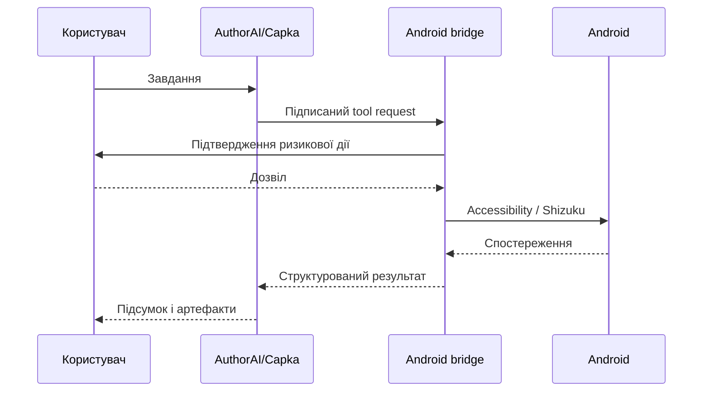

# Архітектура AuthorAI Agent

## 1. Agent Orchestrator

`AgentOrchestrator` зберігає задачу, спостереження, журнал і стан підтвердження. На кожному кроці модель може повернути рівно одну дію або фінальну відповідь. Така гранулярність дає змогу перевірити результат дії перед продовженням і зменшує кількість помилкових ланцюжків.

Модель не має прямого доступу до Android API. Вона бачить лише описи інструментів, а кожен виклик проходить через `ToolRegistry` та `PolicyEngine`.

## 2. Рівні доступу

| Рівень | Механізм | Призначення |
|---|---|---|
| Normal | Android SDK | запуск Activity, сповіщення, локальні дані |
| Accessibility | `AccessibilityService` | структура екрана, click, text, scroll, navigation |
| Shell | Shizuku UserService, UID 2000 | `am`, `pm`, `settings`, `input`, `dumpsys` |
| Root | Sui/Shizuku, UID 0 | ті самі дозволені операції з ширшими системними правами |

Root не скасовує політику програми. Навіть з UID 0 агент виконує лише операції, описані в `CommandPolicy`.

## 3. Політика ризику

| Ризик | Типова поведінка | Приклади |
|---|---|---|
| LOW | виконується в межах задачі | snapshot, запуск застосунку, back, reminder |
| MEDIUM | явне підтвердження | введення тексту, відкриття системних налаштувань |
| HIGH | явне підтвердження | force-stop, grant/revoke permission, settings put |
| CRITICAL | блокується | невідома або довільна shell-команда |

Наступний етап додасть профілі довіри: «підтверджувати кожну дію», «дозволити цю задачу», «завжди дозволяти конкретний інструмент».

## 4. Зв'язок із Capka

Capka працює на сервері та сильна у довготривалих задачах, черзі, MCP, файлових артефактах і відновленні після перезапуску. Android-компонент має стати захищеним device bridge:

Шлюз використовуватиме взаємну автентифікацію пристрою, короткоживучі токени, ідентифікатор задачі, nonce та підпис кожної команди. Сервер не отримає універсальний shell.

## 5. Захоплення екрана й аудіо

Основний канал спостереження — Accessibility tree: він точніший, дешевший і приватніший за постійну відеотрансляцію. MediaProjection потрібна лише коли семантичного дерева недостатньо; Android показує системний діалог і foreground-індикатор.

Телефонний аудіопотік недоступний звичайному APK. Майбутній recorder записуватиме лише дозволене джерело після явного запуску користувачем. Локальна транскрипція має використовувати окремий модуль моделі мовлення та видаляти сире аудіо за обраною політикою зберігання.
